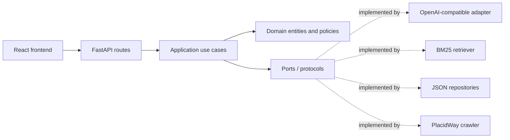

# PlacidWay Grounded Knowledge Chatbot

A safety-first RAG chatbot for the PlacidWay AI Automation Engineer assessment. It answers from exactly seven approved PlacidWay pages, cites server-validated sources, and declines when the supplied content cannot support an answer.

## Architecture

This repository is a **modular monolith**. The React frontend and FastAPI backend are separated by an HTTP contract, while the AI/RAG capabilities remain replaceable backend adapters. This keeps one simple production deployment without coupling business rules to a UI framework, model provider, retrieval engine, or storage format.



Dependency direction is enforced conceptually as:

```text
API ──> Application ──> Domain
Infrastructure ──> Application ports + Domain
Core/container ──> all layers (composition only)
```

The domain and application layers do not import FastAPI, Pydantic, HTTPX, BeautifulSoup, JSON files, or provider-specific code.

## SOLID and patterns

| Principle | Implementation |
|---|---|
| Single Responsibility | Crawling, extraction, chunking, retrieval, prompting, LLM calls, persistence, safety, and API delivery are separate classes/modules. |
| Open/Closed | New retrievers, LLM providers, crawlers, and repositories implement existing ports without changing the use cases. |
| Liskov Substitution | Tests replace production ports with in-memory fakes; implementations preserve the same contracts. |
| Interface Segregation | Small protocols exist for `LLMPort`, `RetrieverPort`, `CrawlerPort`, `KnowledgeRepository`, `GapRepository`, and `FallbackAnswerPort`. |
| Dependency Inversion | `AnswerQuestionUseCase` depends on protocols. Concrete adapters are wired only in `core/container.py`. |

Patterns used because they solve concrete needs:

- **Clean/Hexagonal Architecture** for dependency direction.
- **Ports and Adapters** for providers, retrieval, crawling, and persistence.
- **Repository** for the knowledge snapshot and unanswered-question log.
- **Strategy** for LLM and extractive answer generation.
- **Chain of Responsibility** for deterministic safety policies.
- **Use Case/Application Service** for chat and refresh workflows.
- **Composition Root / Dependency Injection** in `backend/app/core/container.py`.
- **DTO and Mapper** at the FastAPI boundary.

Patterns intentionally avoided: microservices, global service locators, abstract factories, and event buses. They add complexity without helping a seven-page assessment.

## Project structure

```text
frontend/
  src/
    components/             Presentational React components
    features/chat/          Chat state and orchestration hook
    services/api/           Backend HTTP adapters
    types/                  Frontend API contracts
    styles/                 Shared visual system
  tests/                    Frontend unit tests

backend/app/
  api/
    routes/                 FastAPI controllers
    schemas/                Pydantic request/response schemas
    dependencies.py         FastAPI dependency aliases
  application/
    use_cases/              Answer and refresh workflows
    ports/                  Provider-independent protocols
    dto/                    Internal application results
  domain/
    entities/               Chat, source, and knowledge entities
    value_objects/          Query and monetary validation
    policies/               Safety policy chain
  infrastructure/
    ai/                     LLM adapter, prompt builder, fallback
    retrieval/              BM25 implementation
    ingestion/              robots-aware crawler, extractor, chunker
    persistence/            JSON and JSONL repositories
  core/
    config.py               Environment-backed configuration
    container.py            Composition root
  main.py                   FastAPI application factory

backend/tests/
  unit/                     Pure behavior and use-case tests
  integration/              API plus real local adapters
  contract/                 Provider response contract tests

data/                       Versioned knowledge snapshot
scripts/                    Ingestion and assessment runners
docs/                       Supporting documentation
deploy/                     Deployment notes/assets
```

## Grounding and safety controls

1. The crawler receives a fixed seven-source catalog and never discovers links.
2. Every refresh checks `robots.txt`, uses a clear User-Agent, and obeys the current three-second crawl delay.
3. BM25 retrieves at most six passages and includes recent user turns for short follow-ups.
4. The LLM receives numbered evidence only and returns structured source indices.
5. Citations are mapped server-side from retrieved passages; the model cannot invent citation URLs.
6. Monetary values are checked against the selected evidence after generation.
7. Low-confidence retrieval produces an honest fallback and records the content gap.
8. A deterministic safety policy chain handles personalized medical advice, unsupported actions, and out-of-scope questions before an LLM call.
9. If the provider fails or no key is configured, a deterministic extractive adapter remains available.
10. A separate deterministic conversation policy handles greetings, thanks, capability questions, and goodbyes in English without inventing facts or calling the LLM.

## Local setup

Requirements: Python 3.12+ and Node.js 24+.

```powershell
python -m venv .venv
.\.venv\Scripts\Activate.ps1
pip install -r requirements-dev.txt
npm --prefix frontend install
Copy-Item .env.example .env
python scripts\ingest.py
```

Run the backend:

```powershell
uvicorn backend.app.main:app --reload --port 8000
```

Run the frontend development server in a second terminal:

```powershell
npm --prefix frontend run dev
```

Open `http://localhost:5173`. Vite proxies `/api` to FastAPI.

For a production-style local run:

```powershell
npm --prefix frontend run build
uvicorn backend.app.main:app --port 8000
```

FastAPI then serves `frontend/dist` at `http://127.0.0.1:8000`.

## DeepSeek configuration

The chatbot runs safely without a key. DeepSeek is the default online provider and uses its OpenAI-compatible Chat Completions endpoint. Create an API key in your DeepSeek account, then place it only in the local `.env` file or the hosting platform's secret manager:

```dotenv
LLM_PROVIDER=deepseek
DEEPSEEK_API_KEY=your-server-side-key
LLM_BASE_URL=https://api.deepseek.com
LLM_MODEL=deepseek-flash
REFRESH_TOKEN=use-a-long-random-value
ALLOWED_ORIGINS=http://localhost:5173
```

`deepseek-flash` is the default for this assessment. The adapter requests JSON Output and still validates citations and monetary values server-side. Secrets remain server-side and `.env` is ignored by Git.

The generic adapter remains reusable. OpenAI or another compatible provider can be selected by changing `LLM_PROVIDER`, `LLM_BASE_URL`, and `LLM_MODEL`; application and domain code do not change.

## Refreshing content

CLI:

```powershell
python scripts\ingest.py
```

Protected endpoint:

```bash
curl -X POST https://YOUR-DOMAIN/api/refresh \
  -H "X-Refresh-Token: YOUR_REFRESH_TOKEN"
```

The endpoint is disabled without `REFRESH_TOKEN`, and an application lock prevents overlapping refreshes.

## Tests and quality checks

```powershell
python -m pytest
ruff check backend scripts
mypy backend/app scripts
npm --prefix frontend run test
npm --prefix frontend run typecheck
npm --prefix frontend run build
python scripts\run_assessment.py
```

The suite covers domain policies, HTML extraction, Indonesian query expansion, retrieval, dependency substitution, API behavior, refresh authorization, provider response contracts, exact-price grounding, unknown content, and the false-price premise.

See [TEST_RESULTS.md](TEST_RESULTS.md) for the eight required assessment scenarios and [IMPROVEMENTS.md](IMPROVEMENTS.md) for the required limitations write-up.

## Deployment

`render.yaml` deploys the multi-stage `Dockerfile`. The image builds the React application in a Node stage, installs the Python backend in a separate runtime stage, refreshes the knowledge snapshot, and starts one FastAPI service that serves the production bundle.

1. Push the repository to GitHub.
2. Create a Render Blueprint from the repository.
3. Add `DEEPSEEK_API_KEY` as a Render secret and confirm the provider model settings.
4. Verify `/api/health` and keep the public service active for at least seven days after submission.

## Source pages

The fixed catalog is in `backend/app/infrastructure/ingestion/placidway_sources.py` and contains only the seven URLs supplied in the assessment PDF.

